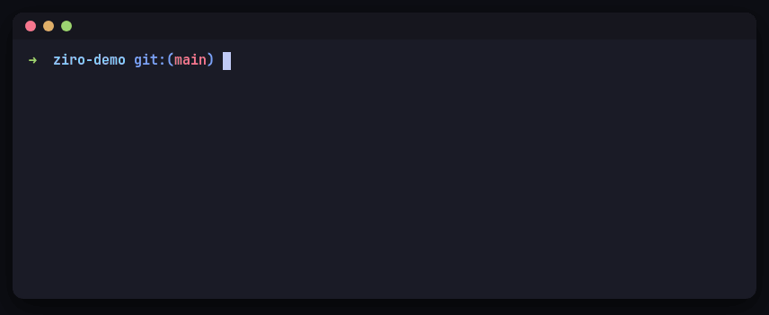

# ziro



На гифке:
- `git ch`: подкоманды с описаниями, Tab / Shift+Tab листают, Enter вставляет, и сразу появляется меню веток;
- `tar -`: опции с нечёткой фильтрацией;
- серая подсказка из истории, принимается клавишей →;
- `pacman -S fire`: список пакетов из штатного completion zsh.

Меню живых подсказок zsh и ghost-text из истории. Кандидаты собирает compsys
в отдельном zpty-процессе, Rust-демон хранит историю, ранжирует подсказки и
готовит кадры для ZLE. Текст меню находится в `POSTDISPLAY`, отдельно от команды.

Текущий статус: рабочий экспериментальный MVP; полная приёмка и все бюджеты
задержек ещё не подтверждены. Подробности: [результаты](spikes/RESULTS.md).

## Запуск из репозитория

Нужны Linux, Rust stable и zsh ≥ 5.8. Рекомендован zsh 5.9.

```sh
cargo build --release
export PATH="$PWD/target/release:$PATH"
ziro init zsh
```

Последняя команда **печатает** строку `source`. Добавьте её в конец `.zshrc`
после oh-my-zsh и подсветчиков или выполните в текущей оболочке:

```zsh
eval "$(ziro init zsh)"
```

Автоматически `.zshrc` не меняется. Для пробного запуска можно использовать
временный `ZDOTDIR`. Внутри inshellisense (`ISTERM` задан) плагин отключается;
для отдельной тестовой оболочки запустите `env -u ISTERM zsh`.

Демон автоматически запускается на новом промпте. Ручной запуск:

```sh
ziro daemon --detach
ziro doctor
ziro stats --json
```

Сокет: `$XDG_RUNTIME_DIR/ziro/daemon.sock`, иначе `/tmp/ziro-$UID/daemon.sock`.
История и лог: `${XDG_STATE_HOME:-$HOME/.local/state}/ziro/`.
`HISTFILE` передаётся при автоматическом старте; импорт не дублирует записи.

## Режим `ziro shell` (плавающее меню у курсора)

```sh
ziro shell            # ваш zsh с вашими rc внутри PTY-обёртки
ziro shell --no-rc    # без пользовательских rc (для проверки)
ziro shell --login    # login-оболочка
```

Обёртка запускает настоящий zsh в PTY, прозрачно пересылает ввод/вывод и
рисует узкое меню поверх экрана: под курсором, а если снизу мало места — над
ним; у правого края сдвигается влево. Ячейки под меню восстанавливаются,
в полноэкранных программах (vim, less) меню не рисуется. Пользовательские
`.zshenv`/`.zprofile`/`.zshrc`/`.zlogin` и `ZDOTDIR` подхватываются как
обычно; плагин подключается после `.zshrc` (если вы уже подключаете его в
`.zshrc`, второй раз он не загрузится). Код выхода, Ctrl+C, Ctrl+Z, resize
сохраняются; при SIGKILL обёртки отдельный guardian возвращает терминал в
нормальный режим и завершает оболочку.

Плагин ищется в `$ZIRO_PLUGIN`, затем `<prefix>/share/ziro/plugin/`, затем
рядом с бинарём в дереве репозитория.

Чтобы открывать его в каждом новом окне kitty, можно указать в
`kitty.conf`: `shell /path/to/ziro shell` (обычный zsh при этом не меняется).

## Производительность

- Воркер разрешает функции completion через скомпилированные `zcompile`
  дайджесты (`${XDG_CACHE_HOME:-~/.cache}/ziro/zwc`, собираются в фоне один
  раз за сессию; `ZIRO_ZWC=0` отключает сборку). fpath самой оболочки не
  меняется. Холодный `git checkout ` ~320 → ~190 мс на этой машине; остальное
  время — сама `_git` и запуски git.
- Повторный контекст (например, снова `git checkout `) сразу показывает прошлый
  ответ и обновляет его, когда compsys досчитает.
- История индексируется в памяти: на 100k записей префиксный поиск ~1 мс.

## Управление

- ↑/↓, Shift+Tab: выбор строки меню; Tab: вставка.
- Enter: вставка после явной навигации, иначе обычное выполнение.
  С `enter_accepts = "auto"` первый пункт выделен сразу, пока набирается слово,
  и Enter вставляет его; после пробела или Esc Enter выполняет команду.
- Меню ставится под курсором: колонку начала строки ввода плагин один раз
  на промпт спрашивает у терминала (DSR), с учётом асинхронного git-промпта oh-my-zsh.
- Esc: скрытие меню до изменения буфера.
- →, End: принятие ghost-text; Ctrl+→: принятие следующего слова.
- PgUp/PgDn: прокрутка. Ctrl+Space: явный вход в меню.
- Если меню скрыто, вызываются прежние виджеты клавиш.

`ZIRO_DISABLE=1` отключает подключение. `ZIRO_BIN` и `ZIRO_SOCKET` задают
бинарь и сокет для изолированного запуска. `ZIRO_TRACE=1` включает замеры
обработки изменений строки; `ZIRO_LOG=debug` включает подробный лог демона.

ziro отключает zsh-autosuggestions, поскольку оба плагина используют
`POSTDISPLAY`. С zsh-autocomplete одновременно подключать его не следует.

## Конфиг

`~/.config/ziro/config.toml` (или `$XDG_CONFIG_HOME/ziro/config.toml`):

```toml
[menu]
max_items = 8
enter_accepts = "explicit" # explicit | auto | always | never

[keys]
arrows = "menu"           # menu | explicit

[worker]
timeout_ms = 3000
refresh_idle_ms = 80

[ghost]
enable = true
```

Полные значения по умолчанию перечислены в [ТЗ, §9](2026-11-13-shell-autocomplete-rust-design.md).
`ziro reload` / SIGHUP перечитывает конфиг демона. После изменения биндингов
откройте новую оболочку. Неизвестные ключи попадают в лог как предупреждения.

## Проверка

Все интеграционные проверки создают временные rc-файлы, сокеты и базы;
пользовательский `.zshrc` не изменяют.

```sh
cargo fmt --all -- --check
cargo clippy --all-targets -- -D warnings
cargo test
cargo build
python3 tests/daemon_smoke.py
python3 tests/shell_smoke.py
python3 tests/ui_smoke.py
python3 tests/overlay_smoke.py      # ziro shell в tmux
zsh -f tests/frame_state.zsh
ZIRO_TEST_OMZ=1 python3 tests/shell_smoke.py
ZIRO_TEST_TMUX=1 python3 tests/shell_smoke.py
ZIRO_TEST_VI=1 python3 tests/shell_smoke.py
ZIRO_TEST_EXPLICIT=1 python3 tests/shell_smoke.py
ZIRO_TEST_RESTART=1 python3 tests/shell_smoke.py
ZIRO_TEST_LIFECYCLE=1 python3 tests/shell_smoke.py
ZIRO_STRESS=1 python3 tests/worker_probe.py
cargo run --release -p ziro-core --example rank_bench
```

Проверка oh-my-zsh предполагает установленный `~/.oh-my-zsh` с плагинами
`git`, `zsh-syntax-highlighting`, `fast-syntax-highlighting`, `zsh-autosuggestions`.

## Демо-гифка

`docs/demo.gif` генерируется скриптом `scripts/demo/record.py`. Он запускает
изолированный zsh с ziro в tmux: временные история, конфиг и состояние,
выдуманный git-репозиторий. Затем «печатает» сценарий, снимает экран после
каждого шага, рендерит кадры headless-Chrome и склеивает их через ffmpeg.

```sh
python3 scripts/demo/record.py            # перезаписывает docs/demo.gif
```

Нужны tmux, oh-my-zsh, установленный `ziro`, google-chrome или chromium,
ffmpeg, ImageMagick, шрифты JetBrains Mono и Noto Color Emoji.
